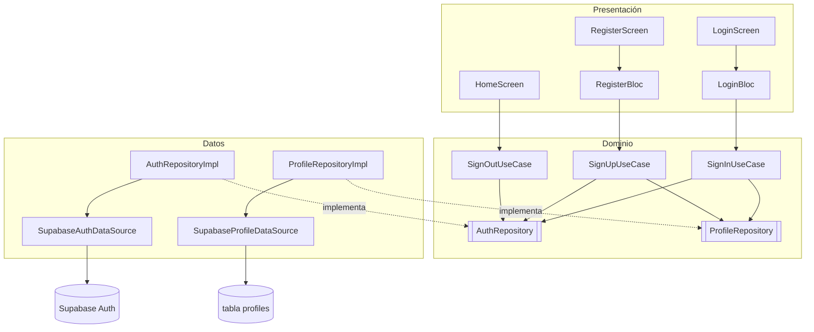

# flutter-supabase-auth

Registro, inicio y cierre de sesión en **Flutter** con **Supabase Auth**, organizado con **Clean Architecture** y **Bloc**.

Registrar no es una operación sino dos: crear la cuenta en Supabase Auth y guardar el perfil en la tabla `profiles` con el mismo `id`. Este proyecto separa esas responsabilidades en capas para que el dominio no dependa de Supabase.

> Proyecto desarrollado en el curso **Aplicaciones Móviles** de la Universidad Icesi (Cali, Colombia), a partir del proyecto base [Domiciano/262App3](https://github.com/Domiciano/262App3).

## Funcionalidades

- Registro con nombre de usuario, nombre completo, correo y contraseña.
- Inicio de sesión con correo y contraseña.
- Pantalla de perfil con los datos de la cuenta (Auth) y del perfil (tabla).
- Cierre de sesión real en Supabase.
- Validaciones locales (campos vacíos, contraseñas distintas) y mensajes de error del servidor.
- Seguridad a nivel de fila (RLS): cada usuario solo puede leer y modificar su propio perfil.

## Arquitectura



| Capa | Responsabilidad | Conoce a Supabase |
|---|---|---|
| **Presentación** | Pantallas y Blocs. Un estado único por pantalla con `status` y `copyWith` | No |
| **Dominio** | Entidades (`AuthUser`, `Profile`, `UserAccount`), contratos y casos de uso. Dart puro | No |
| **Datos** | Implementa los contratos y es el único lugar que usa el SDK | Sí |

`main.dart` es la raíz de composición: el único lugar donde se instancian las clases concretas y se inyectan hacia arriba.

### Flujo del registro

1. `RegisterScreen` valida localmente y lanza `RegisterSubmitted`.
2. `RegisterBloc` emite `loading` y llama a `SignUpUseCase`.
3. `SignUpUseCase` crea la cuenta (`AuthRepository.signUp`) y, con el `id` devuelto, guarda el perfil (`ProfileRepository.createProfile`).
4. El Bloc emite `success` con la `UserAccount` y `BlocListener` navega a `/home`.

Si el paso 3 falla después de crear la cuenta, el caso de uso informa con un mensaje claro (`ProfileNotSavedException`).

## Estructura

```
lib/
├── main.dart                         # Inicializa Supabase y arma las rutas
├── components/                       # Widgets reutilizables
├── theme/
└── features/
    ├── auth/
    │   ├── domain/
    │   │   ├── entities/             # AuthUser, Profile, UserAccount
    │   │   ├── repository/           # Contratos
    │   │   └── usecases/             # SignUp, SignIn, SignOut
    │   └── data/
    │       ├── source/               # Llamadas a Supabase
    │       └── repository/           # Implementaciones de los contratos
    ├── register/ui/                  # RegisterBloc + RegisterScreen
    ├── login/ui/                     # LoginBloc + LoginScreen
    └── home/ui/screens/              # HomeScreen
supabase/migrations/                  # Esquema de la tabla profiles con RLS
test/                                 # Pruebas de widgets con repositorios falsos
```

## Tecnologías

- Flutter / Dart 3
- [flutter_bloc](https://pub.dev/packages/flutter_bloc) ^9.1.1
- [supabase_flutter](https://pub.dev/packages/supabase_flutter) ^2.18.0
- Supabase (Auth + PostgreSQL con RLS)

## Cómo ejecutarlo

### 1. Supabase

1. Crea un proyecto en [supabase.com](https://supabase.com).
2. En **SQL Editor**, ejecuta [`supabase/migrations/20261019230000_create_profiles.sql`](supabase/migrations/20261019230000_create_profiles.sql).
3. En **Authentication → Sign In / Providers**, desactiva **Confirm email** (entorno de desarrollo).
4. Copia la **Project URL** y la **publishable key** desde **Project Settings → API Keys**.

### 2. Flutter

```bash
git clone https://github.com/karenamm/flutter-supabase-auth.git
cd flutter-supabase-auth
flutter pub get
```

Reemplaza `_supabaseUrl` y `_supabasePublishableKey` en `lib/main.dart` por los de tu proyecto y ejecuta:

```bash
flutter run
```

> La *publishable key* está pensada para el cliente; la seguridad la dan las políticas RLS. Nunca uses la *secret key* en la app.

## Pruebas

```bash
flutter test
```

Las pruebas reemplazan los repositorios por implementaciones en memoria (`FakeAuthRepository`, `FakeProfileRepository`), por lo que cubren pantallas, Blocs y casos de uso sin red ni Supabase.

## Autora

**Karen Andrea Mosquera Muñoz** · Ingeniería Telemática e Ingeniería de Sistemas, Universidad Icesi
